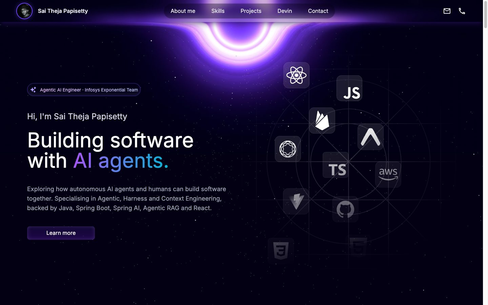
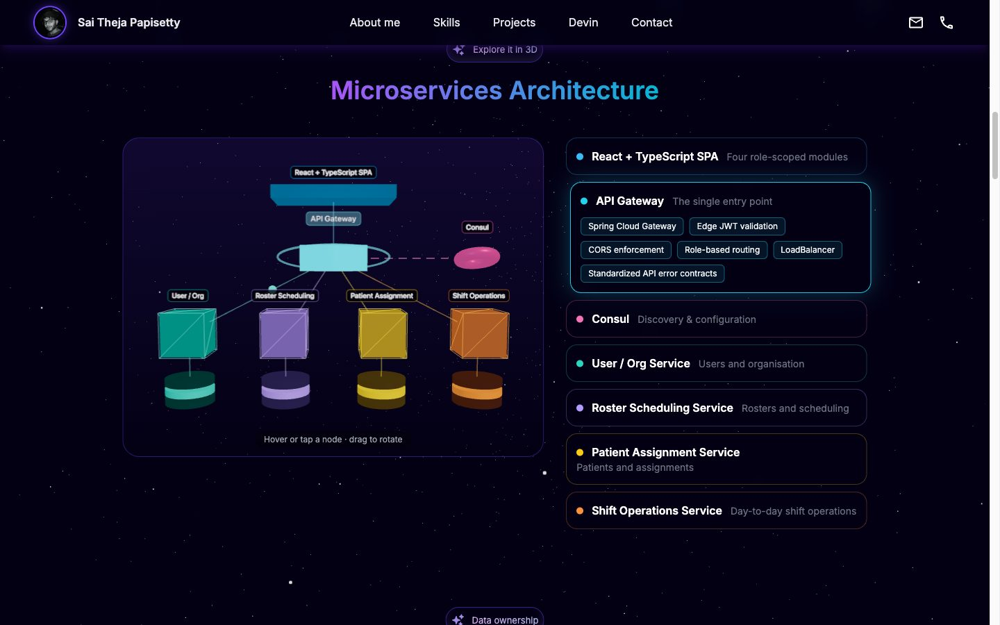
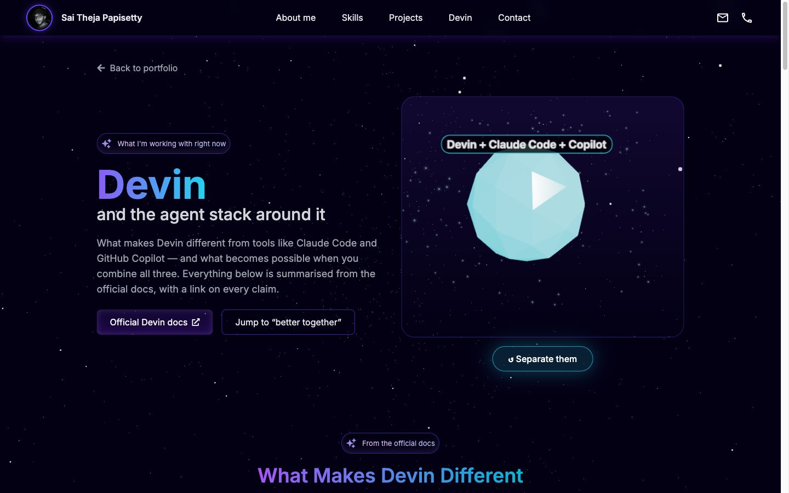
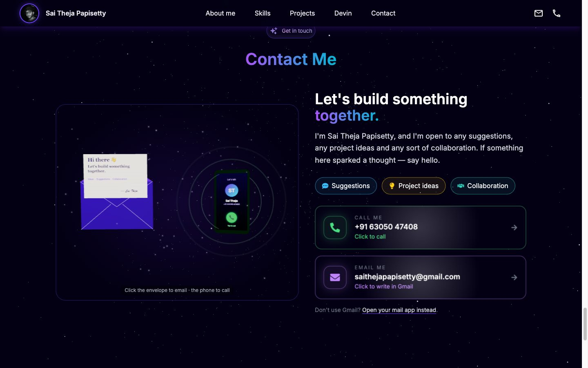

<div align="center">

# Sai Theja Papisetty — 3D Portfolio

**Agentic AI Engineer · Infosys Exponential Team**

A space-themed, interactive 3D portfolio built with Next.js, React Three Fiber and Framer Motion —
with case-study pages, a 3D contact scene, and an explainer on Devin × Claude Code × GitHub Copilot.




</div>

## ✨ What's inside

- **Hero, About & Skills** — a black-hole video hero, an About section with my Infosys background, and skills grouped by Agentic AI, GenAI & RAG, backend, microservices, security, DevOps and frontend.
- **Four project case studies**, each with its own interactive 3D centrepiece:
  | Project | 3D highlight |
  | --- | --- |
  | **DevCommons** — community platform for developers building with AI coding agents | 3D "virtual city" scene, tilting screenshots, lightbox gallery |
  | **Effort Analyzer** — fair, hybrid (deterministic + AI) engineering-effort scoring | 3D model of signals + AI evaluation feeding one score |
  | **UnitedAir AI** — Agentic RAG airline assistant, grounded answers only | Exploded 3D architecture stack, grounded-answer decision flow, 4-layer RBAC |
  | **ShiftTrack** — hospital nurse-shift system on Spring Boot microservices | Interactive 3D microservices explorer with live request pulses |
- **Devin × Claude Code × GitHub Copilot** (`/devin`) — what makes Devin different and what you can do by combining the three, summarised from the official docs with links. Features a rotating 3D prism and a coverflow "relay".
- **3D Contact section** — an envelope that opens as you scroll in and a ringing phone; click to email via Gmail or call.
- **Launchpad footer** — perspective grid floor, a 3D name, and a rocket back-to-top button.







## 🧰 Tech stack

- **Framework:** Next.js 16 (App Router), React 19, TypeScript
- **3D & motion:** three.js, @react-three/fiber, @react-three/drei, maath, Framer Motion, CSS 3D transforms
- **Styling:** Tailwind CSS 3
- **Icons:** react-icons, Heroicons
- **Tooling:** pnpm, ESLint
- **Hosting:** Vercel

## 🚀 Getting started

Requires **Node.js 20.9+** and **pnpm**.

```bash
# install pnpm if you don't have it
npm i -g pnpm

# install dependencies
pnpm install

# start the dev server → http://localhost:3000
pnpm dev
```

> Use **pnpm** rather than npm: `package.json` pins `@types/react` through `overrides`, which npm rejects.

Other scripts:

```bash
pnpm lint    # ESLint
pnpm build   # production build
pnpm start   # serve the production build
```

## 🗂️ Project structure

```
app/                    Routes: / , /devin , /projects/[slug]
components/
  main/                 Page sections (hero, about, skills, projects, contact, footer, …)
  sub/                  Building blocks (TiltCard, 3D scenes, showcases, cards)
constants/
  index.ts              PROFILE, skills, projects, architecture layers
  devin.ts              Content + doc links for the /devin page
config/                 Site metadata
public/                 Videos, skill icons, avatar, project screenshots
```

## 🛠️ Make it yours

- **Your details** — edit the `PROFILE` block at the top of `constants/index.ts` (name, role, bio, email, phone, social links). Anything left as `""` is simply hidden.
- **Projects** — add an entry to `PROJECTS` in `constants/index.ts`. It automatically gets a card on the home page and a detail page at `/projects/<slug>`. Projects can have a screenshot, links, stats, features and an optional bespoke 3D showcase.
- **Skills** — edit `SKILL_GROUPS` in `constants/index.ts`.
- **Avatar** — replace `public/profile-avatar.jpg`.

## ☁️ Deploy

The easiest way is [Vercel](https://vercel.com): import this repository, keep the defaults
(Next.js and pnpm are detected automatically) and click **Deploy**. No environment variables are required.

## 🙏 Credits

This project started from the MIT-licensed
[space-portfolio](https://github.com/sanidhyy/space-portfolio) template by Sanidhya Kumar Verma
(its black-hole hero, starfield and base layout). Everything else — content, case-study pages,
3D scenes, contact section, footer and the Devin explainer — was built on top of it.

The `/devin` page summarises the official documentation of
[Devin](https://docs.devin.ai/), [Claude Code](https://code.claude.com/docs/en/overview) and
[GitHub Copilot](https://docs.github.com/en/copilot). It is an independent, personal write-up and is
not affiliated with Cognition, Anthropic or GitHub.

## 📬 Contact

I'm open to suggestions, project ideas and any sort of collaboration.

- **Email:** [saithejapapisetty@gmail.com](mailto:saithejapapisetty@gmail.com)
- **GitHub:** [@SaiTheja529](https://github.com/SaiTheja529)

## 📄 License

[MIT](LICENSE) — original template © 2024 Sanidhya Kumar Verma; modifications © 2026 Sai Theja Papisetty.
